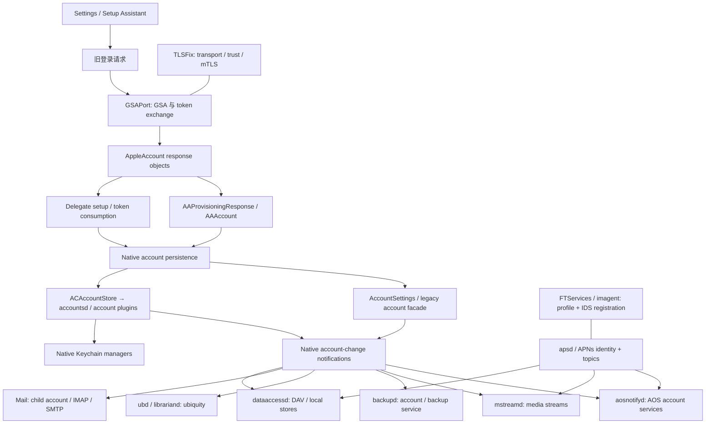

# iOS 6 iCloud 同步架构与适配边界

研究日期：2026-10-22（Australia/Sydney）。目标设备：用户报告的 iPod touch 5、iOS 6.1.3。本文分析公开源码、版本化运行时头文件和用户提供的现象；不代表已在该设备完成动态验证。

## 1. 证据状态与核心判断

当前最合理的实现是：**保留 GSAPort/TLSFix，观察 native provisioning 的每一跳，在可验证的窄边界调整响应，让 iOS 6 自己保存账户、凭据和通知**。现有材料不足以直接编造一套 CalDAV/CardDAV/Backup/ubiquity 的 Keychain 项目。

| 编号 | 事实或主张 | 当前强度 | 对实现的约束 |
|---|---|---|---|
| R01 | 至少某次 GSA init/complete 成功；complete 含 `hsc=200`、`ec=0`、`M2/spd/np` | 本次任务说明和引用对话转述；原始 `GsService2-1.log` 尚未在当前工作区重新取得 | 保留成功记录，不把后续失败一概归咎 SRP |
| R02 | `loginDelegates` overall/delegate status 0 并下发 service tokens | 用户报告；尚缺该次完整原始响应 | 证明至多到该 delegate 的协议成功，不证明 native 消耗/持久化成功 |
| R03 | required dataclasses、CalDAV Keychain `-25300`、missing store、backupd accountID null | 用户报告；尚缺带进程、时间和事务边界的 `ipod.log` | 是独立观察点，不能未经关联串成唯一因果链 |
| V01 | iOS **6.1** 运行时有独立 provisioning、delegate setup、dataclass、credential、notifier API | 已读版本化头文件 | 可据此挑选观察点；调用前仍需检查 6.1.3 实机 ABI |
| V02 | 当前 GSAPort 已做 PET→authenticate→account settings、delegate token 替换 | 已读固定 commit 源码 | 先确定设备安装版本；不能重复叠加同一转换 |
| V03 | 旧版 Backup、My Photo Stream、Documents and Data 有服务终止边界 | Apple 官方文档 | 本地状态修复与后端复活分开验收 |

这里的「推断」指从命名和接口关系提出的可测模型；头文件没有方法实现，不能用它证明调用顺序、字典键映射、数据库事务范围、Keychain access group 或 Darwin notification 名称。iOS 6.1 的 tag 已解析到 commit `76cc1d4a6e6bc5546f04448535f9e64ec22a9716`；它不是 iOS 6.1.3 的固件 dump。[版本来源][TAG]

## 2. 分层模型



这是待实机追踪的边界图，不是已证明的逐指令调用图。关键是区分五种成功：TLS 握手、GSA proof、delegate 返回、native 持久化、具体服务同步。任一层成功都不能替代下一层的证据。

### 2.1 Accounts 与 AccountSettings 并存

`ACAccount` 在 6.1 有 parent/child account、DSID、credential、enabled/provisioned dataclasses 和每个 dataclass 的 properties；`ACAccountStore` 通过 XPC proxy 访问守护侧，同时提供 credential renewal 和 save/verify 两条路径。[ACAccount][H01]、[ACAccountStore][H02]

另一侧，`AAAccount` 继承 `BasicAccount`，同时持有 backing Apple ID `ACAccount`。`BasicAccount` 和 `AccountsManager` 仍表达 legacy account properties、DAV/IMAP child account、sync store 和保存通知。[AAAccount][H04]、[BasicAccount][H16]、[AccountsManager][H15]

**推断：** iOS 6 是账户存储迁移期；Settings 中显示一个 iCloud 账户，不足以证明供 DataAccess 使用的 child/backing account、persistent UUID、store 都齐全。不能只修一份 plist 或 Accounts 数据库中的一个字段就认定一致。

### 2.2 四类标识不能混用

1. Apple ID 登录字符串及 aliases。
2. Apple 发行的 DSID/person ID（与当前协议中的 ADSID 不可未经证明互换）。
3. 本地 ACAccount identifier、parentAccountIdentifier。
4. DataAccess persistentUUID、accountID、syncStoreIdentifier。

这些 getter 在相应接口分别存在，已足以说明其职责有区别。[H01]、[H04]、[H18] `backupd accountID=(null)` 也不能直接用 DSID 填进去：它究竟要求哪个标识，需该版 daemon 调用点或动态观测证明。

## 3. setup 登录与 loginDelegates 的消费

### 3.1 当前 GSAPort 的实际范围

公开仓库 `Epixx512/GSAPort` 的固定 commit `a4ef5dddecd48e1a5839980d3f5f39e6650fbd7d` 中：

- `NSURLProtocol` 选择 `setup.icloud.com` 的登录、delegate、authenticate、settings 路径。
- `login_or_create_account` 分支用 GSA 返回的 PET 调用 `/setup/authenticate/<username>`；取 `appleAccountInfo.dsid` 与 `tokens.mmeAuthToken`，再调用 `/setup/get_account_settings`，把其响应交回旧 caller。
- `loginDelegates` 分支替换请求中的 Apple ID/PET，并在 `com.apple.mobileme.tokens` 存在时，额外取得 account settings 的 `tokens` 并替换该 delegate 的 token 字典。
- 安装 filter 覆盖 Preferences、accountsd、gamed、imagent 和部分 Find My 应用；源码范围与设备实际安装范围仍需核对。

这些是源码行为，**不是该用户设备版本或实时 Apple 服务结果**。[GSAPort 源码][GSA]、[filter][GSAFILTER] 不复制该仓库未明确授权的实现；本项目采用独立窄层实现。

由此不能再把工作描述成「GSAPort 完全只管 SRP」。它也已触及 token 与响应兼容。新增层应记录包版本、已加载镜像、endpoint kind、HTTP/parse status 和回调链，避免与 GSAPort 争抢所有权。

### 3.2 iOS 6.1 本地对象边界

| 对象/边界 | 版本化接口已证实 | 可观测内容 |
|---|---|---|
| `AAResponse` | HTTP/data initializer、plist parser、responseDictionary、error | URL kind、HTTP status、plist root 是否字典、已知 key 的 presence/type；不打印字典 |
| `AAAuthenticationResponse` | authToken、fmipToken、personID | getter 的非空布尔值；不读出用于日志 |
| `AAProvisioningResponse` | dataclassProperties、provisionedDataclasses、dictionary initializer | provisioning capability 是否出现、结构是否合理 |
| `AASetupAssistantSetupDelegatesResponse` | status、dsid、responseParametersForServiceIdentifier: | overall 与每个被请求 delegate 的状态分别判断 |
| `AADelegateAccountSetupHelper` | adjust response、store delegate tokens、complete delegate setup | 原方法是否执行、进入/离开、异常；不自行重放 |
| `AAAccount` | updateAccountWithProvisioningResponse:、saveTokensInKeychain、becomeConfiguredSyncAccount | native provisioning 后是否实际到 token save、configured-sync 检查 |

来源：[AAResponse][H07]、[AAAuthenticationResponse][H06]、[AAProvisioningResponse][H05]、[delegates response][H09]、[helper][H08]、[AAAccount][H04]。

**推断性的待测链：** HTTP data → response parser → delegate response adjustment/token consumption → provisioning/account update → native store save → notifier → consumer reload。不能仅凭一次 `status=0` 跳过中间步骤。

### 3.3 三个容易忽略的响应兼容点

1. **回调的 response URL。** 当前 GSAPort 登录分支把内部 settings 请求的 response 原样交还旧登录 caller。AquaTransport 的独立实现明确把响应 URL 映回原请求，并处理变换后的 metadata。只在确认目标 endpoint、真实 HTTP 成功和预期响应结构后修正 URL/过期 headers，是比猜 token 的窄切口；尚无证据它就是本案根因。[GSA]、[AQUA]
2. **压缩/长度与正文一致。** 已解压或重序列化正文不能继续声明原 Content-Encoding、Content-Length；不得重复解压、错误缓存或把 error body 伪装成 success。
3. **状态有层次。** HTTP 200、overall status、MobileMe delegate status、native response error 分别记录。不能把缺失/字符串/非零 status 默认成成功。GSAPort 的 GSA `ec=0` 也不是 delegate status。

不得把一个 nested `service-data` 无条件 flatten 到整个 response，也不得将所有 `tokens` 同名视作同用途。对照样本缺失时，只能产出候选差异与日志，不能自动迁移 secret。

## 4. Dataclass 状态机

6.1 的 API 明确区分：account type supported/syncable、账户 provisioned、用户 enabled、最终 enabled-to-sync。`ACAccount` 同时有 `provisionedDataclasses`、`enabledDataclasses`、`enabledAndSyncableDataclasses` 以及 `propertiesForDataclass:`；`BasicAccount` 还区分用户启用动作和需要确认的 dataclass。[H01]、[H02]、[H16]

可采用的诊断模型是：

```text
可供同步 = 本版客户端支持 ∩ 服务端已 provision ∩ 用户已启用 ∩ 身份/属性/凭据有效
```

这是模型，不是逆向所得内部实现公式。`required dataclasses for syncing` 可能来自其中任一前置条件或主账户绑定检查。收集发生时间与实际集合规模，再用白名单标识定位；不能把所有已知 dataclass 一次设 enabled，也不能把 server 已撤回能力重新设 provisioned。

安全写入的后续门槛：先确认 response 中确有该能力，保存前/后账户一致，用户在 Settings 选择启用，相关 native setter、save completion 和 consumer reload 都被观察到。优先让原 `updateAccountWithProvisioningResponse:` / Settings 流程完成；桥接层不制造新的全局同步开关。

## 5. Keychain 与各服务凭据

`errSecItemNotFound=-25300` 是查询未匹配到项目，不能单凭它得出「密码错误」或「GSA proof 错误」。查询 class/service/account/access group/persistent reference/可访问状态均可能影响结果；应在原查询上下文定位，而不是遍历整个 Keychain。[Apple Security 常量][SEC]

| 服务 | 6.1 可证本地边界 | 必须进一步证明 | 当前最小动作 |
|---|---|---|---|
| Apple ID / MobileMe | `ACAccountCredential` 有分服务 token 项；`AAAccount` 有 native token/password save；AA/ACD Keychain managers 负责内部 item 组织 | 当前响应 token 与 native credential item 的确切对应；save completion；服务组 | 观察原保存调用，只记返回/异常/类型；不缓存密码/PET |
| CalDAV / CardDAV | `DAAccount` 有 backing account、backingCredentialAccount、persistentUUID、passwordWithExpected:；`DAKeychain` 有按 UUID 的查询和保存 | 当前为 modern backing credential 路径还是 legacy DAKeychain 路径；实际 UUID 与 child关系 | 观察原 lookup/save 与 `-25300`；不自行取主密码充填 |
| Mail / Notes | `AAAccount` 有 child Mail setup；`BasicAccount` 有 IMAP child 与 Notes validity | native child account 使用密码、token还是其他 SASL；协议与 TLS分别验收 | 保留 native save；手动 Mail 的替代路径单独记录 |
| Backup | 当前缺少该版 backupd 的 cloud-account implementation | null accountID 的来源、服务 token 类型及现存后端 | 只诊断；不生成备份凭据或宣称云备份可用 |
| Ubiquity | 6.1 Foundation 有 identityToken/container API（H27）；Librarian 有 account-change observer | 实机 daemon、entitlement、服务代际、token retrieval | presence/可用性观察；不写 ubiquity 数据目录或 token |

凭据边界来源：[ACAccountCredential][H03]、[AAKeychainManager][H11]、[ACDKeychainManager][H12]、[DAAccount][H18]、[DAKeychain][H17]。

尤其不要把 MobileMe MME token、GSA PET、Madrid auth token、APNs token、ubiquity identity token 互当通用 bearer credential。`ACAccountCredential` 已表现出按服务分项，DAKeychain 还可能按本地 UUID 寻址。主账户 getter 有值，不证明 child account 查询会得到同一项。

### 5.1 最小凭据追踪规则

- 只在目标进程和单次测试窗口内观察原 `SecItemAdd/Update/CopyMatching`；不执行额外枚举，不请求返回 secret data。
- 记录 operation、OSStatus、item class、安全白名单 key 的 presence/type 和返回地址所在 image；默认不记录 service/account/access-group 的原始字符串。
- UUID/账号关联只能使用当次进程内随机短标签；不可用 Apple ID 或密码的稳定 hash。跨进程如需对照，采用用户保留在本机的受保护映射或明确受控 session salt，不能把 salt 与原始身份一起上传。
- 不能为了「确认存在」把 Keychain item 改成更宽 accessibility、加入猜测 access group、替换 persistent reference 或取消调用方权限检查。
- `SecItemAdd` success 还应有原 consumer read success；某次 `-25300` 消失不能替代真实同步读写测试。

## 6. 账户保存与通知/daemon 刷新

`ACDAccountStore` 具有 save、关系建立、凭据读取和权限检查；`ACDAccountNotifier` 具有 will/did change notification plugin 调用。旧 `AccountsManager` 同时有 dataclass will/did change、保存所有账户、发送变更通知。`DAAccountManager` 有响应账户通知和 reload；`LBAccountNotification` 有 `noteAccountChanges:`。[H14]、[H13]、[H15]、[H19]、[H22]

这说明正确顺序应由 native 保存流程主导。普通进程里发一次 `ACAccountStoreDidChangeNotification` 并不等价于 daemon/plugin 通知。公有通知说明见 [Apple ACAccountStore 文档][APPLEAC]，但具体跨进程通知名和 payload 不能从现代版本抄来。

| 进程/子系统 | 研究结论 | 实机要证明的刷新证据 |
|---|---|---|
| `accountsd` | Accounts 数据库、验证/访问/通知插件的守护侧边界 | 原 save handler success、native notifier被调用、无递归 renewal |
| `dataaccessd` | DataAccess 账户重载、DAV发现、local stores | reload后目标 child account进入；凭据读取成功；发现principal/collection；原本missing store由native建立 |
| `backupd` | 本案 null accountID 是待追踪症状；公开 MobileBackup头不足以确定 cloud-daemon实现 | null来源消除与原account query关联；不把它当作已恢复云备份 |
| `ubd` | 文档同步传输的候选系统角色；当前没有该固件 daemon本体证据 | launchd job存在与binary版本、实际loaded frameworks、account change后行为 |
| `librariand` | 有 6.1 Librarian account notification类，表明独立账户变更接口 | 实际job/进程、native notification→查询可用性；不虚构内部reload selector |
| `mstreamd` | 6.1 CoreMediaStream含按personID处理认证、push、polling的daemon对象 | native account/认证回调与push/poll分别记录；My Photo Stream后端已关闭 |
| `aosnotifyd` | AOSNotification有add/remove account、按service取当前账户、topic监听 | 实际当前账户注册状态、topic订阅；不主动remove/re-add账户 |

`MSMediaStreamDaemon` 的接口区分认证结果、收到push、poll subscription；`AOSNotifySession` 区分账户和topic。[H23]、[H21] 表中进程名来自用户目标和常见系统角色；未取得相应 iOS6.1.3 launchd plist/binary前，进程与类的具体承载关系仍为待验证项。

优先复现一个 Settings 开关带来的 native reload。除正常安装使新动态库加载外，不把 `killall` 全部 daemon当修复，不在 save callback 内发送未知Darwin通知。注销、删库、清空 Keychain、删除 stores 都不能作为初始化步骤。

## 7. APNs 与 IDS：平行依赖

6.1 `APSConnection` 有 device identity、public token、connection状态、topics/subtopics；`FTPushHandler` 单独表达push token、topics和registered状态。iCloud服务可用的APNs连接，与Apple ID取得某个服务token属于不同状态。[H20]、[H26]

TLSFix提供现代TLS、系统trust评估和client identity签名路径，是传输适配；它不能凭空制造激活identity、签发APNs证书、注册topic或创建本地iCloud账户。[TLSFix README][TLS] `X-APNS-Token` 被某次请求携带也不足以证明push有效，且它本身是敏感device标识，不打印。

IDS/profile链在6.1由FTServices接口体现：`FTProfileAuthenticationMessage`输出profile ID/authorization token；`FTRegistrationMessage`另有validationData、capabilities、protocol/software版本及responseBindings。[H24]、[H25] 因此 `com.apple.madrid` delegate成功不等于IDS registration成功，更不证明iMessage收发或FaceTime通话。不要把新版`identityservicesd`类名、AuthKit接口或macOS行为硬移到iOS6。

建议验收分开：APNs mTLS/identity存在→连接可达→topic注册→native消息到达；profile auth→registration bindings→真实收发。先用手动刷新验证DAV，以便把推送延迟与数据协议故障区分。桥接层第一版不改APNs identity、IDS证书和设备激活状态。

## 8. 协议/版本翻译应按服务分割

### 8.1 DAV是最适合优先闭环的服务

CalDAV/CardDAV仍有明确WebDAV发现与同步模型：principal/home-set发现、collection查询、multi-status、ETag、条件写入、sync-token。协议依据为[RFC 4791][RFC4791]、[RFC 6352][RFC6352]、[RFC 6578][RFC6578]。这些规范不是iCloud专有鉴权规范。

AquaTransport在OS X 10.7–10.9实现的DAV路径保留native credential/challenge、method/body、流式响应，并有精确host/port与redirect检查；其文档报告某Mavericks环境额外device headers能把DAV发现由401变207。这是**作者对另一平台的验证报告**，不证明iOS6也必须或已经能如此工作。[AQUA]

后续DAV适配的门槛是：native child/store和凭据已有效，TLS成功，实际401/协议不兼容可定位，且设备自身已存在可调用的device authentication provider。仅此时添加该服务所需的fresh headers/受限端口翻译。跨origin redirect不能继承凭据/device headers；拒绝外部host、userinfo和未知端口；保留ETag、DAV、Location、WWW-Authenticate语义。不要代理整机流量或把账号发送给远程anisette服务。

### 8.2 Mail另有SASL与TLS边界

iCloudMailFix当前README明确仅支持手动添加的iCloud Mail账户，默认Settings→iCloud的Mail账户尚不支持；它采用本地TLS代理路径。它可用来界定服务范围，不能当作本案provisioning修复证据。[MAIL]

AquaTransport还报告macOS Mail旧ATOKEN的device字段适配；相关selector是macOS MailCore细节。未经iOS6 Mail binary或头文件验证，不能照搬 `_MCAppleTokenSaslClient` 或直接把某个MME token当IMAP password。先确定本机Mail child如何取得凭据，再判断TLS、SASL、服务授权分别是哪一层失败。[AQUA]

### 8.3 已终止/已迁移服务限制

- Apple规定从**2024-12-18**起iOS5–8不能新建iCloud备份、旧备份不能访问。因此修复backupd的null accountID，不足以恢复官方Backup。[Apple Backup说明][BACKUP]
- **My Photo Stream于2023-07-26关闭**。它与Shared Albums、iCloud Photos不是同一服务；不能用其中一项成功推断其他项。[Photo Stream说明][PHOTOS]
- Apple存档确认旧Documents and Data已停并迁往iCloud Drive。iOS6的ubiquity identity/container API存在，并不赋予现代Drive能力。[迁移说明][DOCSDATA] iOS8才引入CloudKit；不要设计一个并不存在的iOS6 CloudKit native consumer。[iOS8发布说明][CLOUDKIT]

完整旧接口→现代存储协议translator将需要服务数据模型、容器entitlement、冲突/删除语义、上传/download token、加密与重试持久化，是独立工程。第一版只观察这些子系统，明确标记unavailable/unsupported，不伪造capability或success。

## 9. 从现象到可证伪假设

| 假设 | 支持线索 | 反证/确认测试 | 不应据此执行 |
|---|---|---|---|
| 某次响应被旧parser拒绝或消费不全 | delegate成功但未见dataclass和credential落地；上游有response兼容转换 | 同一事务response→native parser→provision/update→save的事件链；仅比较结构 | flatten任意nested字典 |
| 父/子账户或configured-sync绑定不全 | missing store、required dataclasses、null accountID并存 | parent/child存在性、enabled/provisioned/syncable、native store创建 | 填入猜测accountID、重建整个账户 |
| credential写入/查询key不一致 | CalDAV -25300 | 原生save/lookup的operation/status、persistentUUID关系 | 复制主密码或跨access group写入 |
| 某renewal调用者收到不同credential | 用户报告多轮GSA有成功也有失败 | 以pid/thread/本地事务编号关联每次request/renewal | 认为一次成功代表以后全部成功 |
| 具体服务协议过旧 | 传输/账户已正常却服务401/协议错误 | 每服务独立read-only discovery，保留实际错误 | 全局提高client版本或全部endpoint重写 |
| 已终止服务仍被旧daemon调度 | Apple服务终止文档 | local state正常且该功能明确已停止 | 将重试/假success视作修复 |

## 10. 建议实施顺序与完成条件

1. **来源与基线。** 取得两份原始日志的本地只读副本或sanitized摘录、校验hash；记录系统build、硬件、GSAPort/TLSFix包版本及加载镜像。原始日志不得提交到公开仓库。
2. **观察优先。** runtime存在性与ABI guard安装hooks；只记录target endpoint结构、native parse/provision/token-save/account-save/consumer阶段。unknown class/encoding必须skip，而非猜签名调用。
3. **单次登录证据链。** 一次用户正常Settings操作，明确各成功/失败边界；不自动反复提交密码/验证码，不生成额外认证请求。
4. **窄响应兼容。** 只对已识别的成功响应纠正metadata；任何body/semantic改写都需要真实schema证据与失败fixture，保留原始response/error语义。
5. **native安全写入。** 优先原消费者已拥有的账户对象和凭据上下文；若未来确需补dataclass property，仅补原响应已证明的缺失值，不能覆盖冲突值；必须native save completion、idempotence和rollback。凭据、UUID关系、未知token映射没有证据则停在诊断。
6. **先闭环Calendar/Contacts。** native账户有效→Keychain原查询成功→发现collection→下载一个测试项→受控创建/修改/删除→另一设备验证；然后单独测push。
7. **扩展其他服务。** Mail、AOS/IDS分别建立protocol fixture和实机结果；Backup/Photo Stream/旧Documents按官方服务边界呈现，不能列为已修复。

本项目首个可交付完成条件是「可审查、可构建、可禁用的诊断/窄兼容层及测试矩阵」，而非「所有iCloud服务已恢复」。本机源码检查或合成fixture通过不等于Mach-O在iOS6载入、不等于用户账号真实同步成功。实机结果必须单独记录。

[TAG]: https://api.github.com/repos/nst/iOS-Runtime-Headers/git/tags/ee780af2247b2e8aa26b5f98305c1287c8de4251
[H01]: https://github.com/nst/iOS-Runtime-Headers/blob/76cc1d4a6e6bc5546f04448535f9e64ec22a9716/Frameworks/Accounts.framework/ACAccount.h
[H02]: https://github.com/nst/iOS-Runtime-Headers/blob/76cc1d4a6e6bc5546f04448535f9e64ec22a9716/Frameworks/Accounts.framework/ACAccountStore.h
[H03]: https://github.com/nst/iOS-Runtime-Headers/blob/76cc1d4a6e6bc5546f04448535f9e64ec22a9716/Frameworks/Accounts.framework/ACAccountCredential.h
[H04]: https://github.com/nst/iOS-Runtime-Headers/blob/76cc1d4a6e6bc5546f04448535f9e64ec22a9716/PrivateFrameworks/AppleAccount.framework/AAAccount.h
[H05]: https://github.com/nst/iOS-Runtime-Headers/blob/76cc1d4a6e6bc5546f04448535f9e64ec22a9716/PrivateFrameworks/AppleAccount.framework/AAProvisioningResponse.h
[H06]: https://github.com/nst/iOS-Runtime-Headers/blob/76cc1d4a6e6bc5546f04448535f9e64ec22a9716/PrivateFrameworks/AppleAccount.framework/AAAuthenticationResponse.h
[H07]: https://github.com/nst/iOS-Runtime-Headers/blob/76cc1d4a6e6bc5546f04448535f9e64ec22a9716/PrivateFrameworks/AppleAccount.framework/AAResponse.h
[H08]: https://github.com/nst/iOS-Runtime-Headers/blob/76cc1d4a6e6bc5546f04448535f9e64ec22a9716/PrivateFrameworks/AppleAccount.framework/AADelegateAccountSetupHelper.h
[H09]: https://github.com/nst/iOS-Runtime-Headers/blob/76cc1d4a6e6bc5546f04448535f9e64ec22a9716/PrivateFrameworks/AppleAccount.framework/AASetupAssistantSetupDelegatesResponse.h
[H10]: https://github.com/nst/iOS-Runtime-Headers/blob/76cc1d4a6e6bc5546f04448535f9e64ec22a9716/PrivateFrameworks/AppleAccount.framework/AASetupAssistantService.h
[H11]: https://github.com/nst/iOS-Runtime-Headers/blob/76cc1d4a6e6bc5546f04448535f9e64ec22a9716/PrivateFrameworks/AppleAccount.framework/AAKeychainManager.h
[H12]: https://github.com/nst/iOS-Runtime-Headers/blob/76cc1d4a6e6bc5546f04448535f9e64ec22a9716/PrivateFrameworks/AccountsDaemon.framework/ACDKeychainManager.h
[H13]: https://github.com/nst/iOS-Runtime-Headers/blob/76cc1d4a6e6bc5546f04448535f9e64ec22a9716/PrivateFrameworks/AccountsDaemon.framework/ACDAccountNotifier.h
[H14]: https://github.com/nst/iOS-Runtime-Headers/blob/76cc1d4a6e6bc5546f04448535f9e64ec22a9716/PrivateFrameworks/AccountsDaemon.framework/ACDAccountStore.h
[H15]: https://github.com/nst/iOS-Runtime-Headers/blob/76cc1d4a6e6bc5546f04448535f9e64ec22a9716/PrivateFrameworks/AccountSettings.framework/AccountsManager.h
[H16]: https://github.com/nst/iOS-Runtime-Headers/blob/76cc1d4a6e6bc5546f04448535f9e64ec22a9716/PrivateFrameworks/AccountSettings.framework/BasicAccount.h
[H17]: https://github.com/nst/iOS-Runtime-Headers/blob/76cc1d4a6e6bc5546f04448535f9e64ec22a9716/PrivateFrameworks/DataAccess.framework/DAKeychain.h
[H18]: https://github.com/nst/iOS-Runtime-Headers/blob/76cc1d4a6e6bc5546f04448535f9e64ec22a9716/PrivateFrameworks/DataAccess.framework/DAAccount.h
[H19]: https://github.com/nst/iOS-Runtime-Headers/blob/76cc1d4a6e6bc5546f04448535f9e64ec22a9716/PrivateFrameworks/DataAccess.framework/DAAccountManager.h
[H20]: https://github.com/nst/iOS-Runtime-Headers/blob/76cc1d4a6e6bc5546f04448535f9e64ec22a9716/PrivateFrameworks/ApplePushService.framework/APSConnection.h
[H21]: https://github.com/nst/iOS-Runtime-Headers/blob/76cc1d4a6e6bc5546f04448535f9e64ec22a9716/PrivateFrameworks/AOSNotification.framework/AOSNotifySession.h
[H22]: https://github.com/nst/iOS-Runtime-Headers/blob/76cc1d4a6e6bc5546f04448535f9e64ec22a9716/PrivateFrameworks/Librarian.framework/LBAccountNotification.h
[H23]: https://github.com/nst/iOS-Runtime-Headers/blob/76cc1d4a6e6bc5546f04448535f9e64ec22a9716/PrivateFrameworks/CoreMediaStream.framework/MSMediaStreamDaemon.h
[H24]: https://github.com/nst/iOS-Runtime-Headers/blob/76cc1d4a6e6bc5546f04448535f9e64ec22a9716/PrivateFrameworks/FTServices.framework/FTProfileAuthenticationMessage.h
[H25]: https://github.com/nst/iOS-Runtime-Headers/blob/76cc1d4a6e6bc5546f04448535f9e64ec22a9716/PrivateFrameworks/FTServices.framework/FTRegistrationMessage.h
[H26]: https://github.com/nst/iOS-Runtime-Headers/blob/76cc1d4a6e6bc5546f04448535f9e64ec22a9716/PrivateFrameworks/FTServices.framework/FTPushHandler.h
[H27]: https://github.com/nst/iOS-Runtime-Headers/blob/76cc1d4a6e6bc5546f04448535f9e64ec22a9716/Frameworks/Foundation.framework/NSFileManager.h
[GSA]: https://github.com/Epixx512/GSAPort/blob/a4ef5dddecd48e1a5839980d3f5f39e6650fbd7d/Tweak.x
[GSAFILTER]: https://github.com/Epixx512/GSAPort/blob/a4ef5dddecd48e1a5839980d3f5f39e6650fbd7d/GSAPort.plist
[TLS]: https://github.com/nfzerox/TLSFix/blob/d98825f45322f9a743fc3703eedc77098bec7efc/README.md
[AQUA]: https://github.com/Wowfunhappy/AquaTransport/blob/4af032dbba7f57715523abed75fba406110ab614/docs/ICLOUD.md
[MAIL]: https://github.com/victorlobe/iCloudMailFix-Tweak/blob/229f836e9cae3cf02408ff6f777f01ab822ba1ac/README.md
[SEC]: https://github.com/apple-oss-distributions/Security/blob/db15acbe6a7f257a859ad9a3bb86097bfe0679d9/base/SecBase.h
[APPLEAC]: https://developer.apple.com/documentation/accounts/acaccountstore?language=objc
[BACKUP]: https://support.apple.com/en-au/120863
[PHOTOS]: https://support.apple.com/en-us/102645
[DOCSDATA]: https://support.apple.com/en-us/111757
[CLOUDKIT]: https://developer.apple.com/news/?id=06022014b
[RFC4791]: https://www.rfc-editor.org/rfc/rfc4791.html
[RFC6352]: https://www.rfc-editor.org/rfc/rfc6352.html
[RFC6578]: https://www.rfc-editor.org/rfc/rfc6578.html
